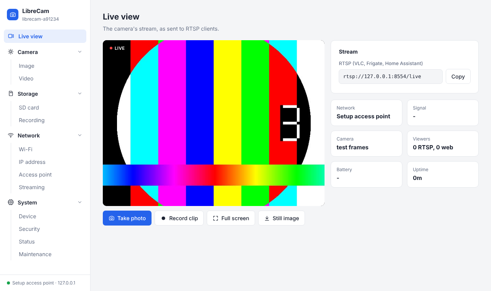
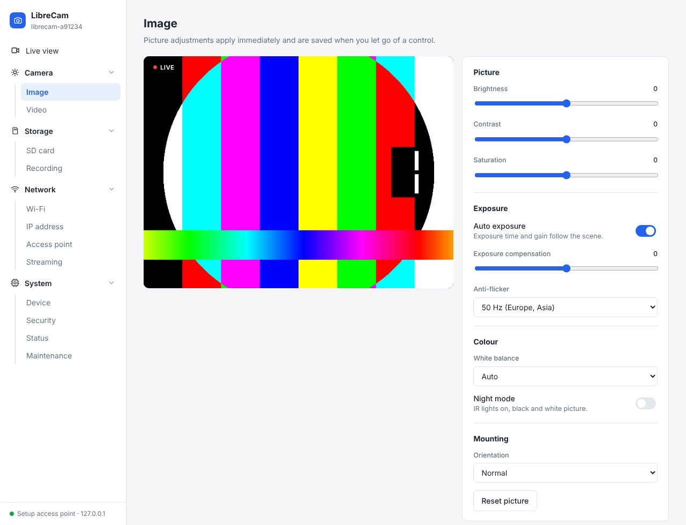
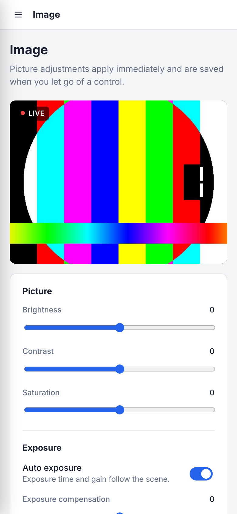
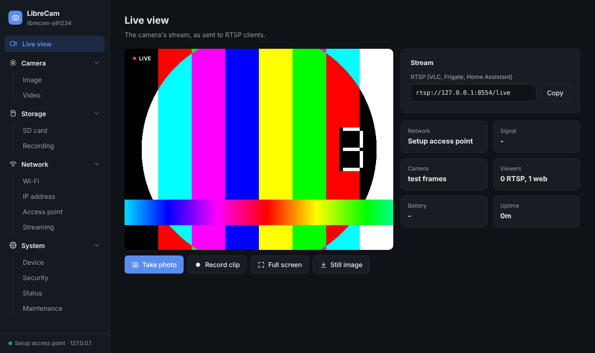

# LibreCam

Open replacement firmware for cheap cloud-locked Wi-Fi cameras. It runs entirely on the camera and needs no cloud account or app:

- **Web UI** with a live view, image controls (brightness, contrast, exposure, white balance, night mode), Wi-Fi and static IP settings, and an SD card browser
- **RTSP stream** with sound, for VLC, Frigate and Home Assistant
- **Found by name** on the local network over mDNS (`<device-name>.local`), with the web UI and stream advertised for discovery
- **SD card recording**: photos and video clips (on cameras with a card slot)
- **Setup access point** on first boot, or **Wi-Fi setup from the SD card** with a `wifi.txt` file
- **Deep sleep** on the power button

Chip and board specifics sit behind a HAL, so more cameras can be added. Everything beyond flashing is in [docs/details.md](docs/details.md).

<p align="center"></p>

## Screenshots

The web UI, rendered by the host build with its test pattern as the camera:

| Live view | Image controls | Phone | Dark theme |
|---|---|---|---|
| [](docs/screenshots/live-light.png) | [](docs/screenshots/image-light.png) | [](docs/screenshots/phone.png) | [](docs/screenshots/live-dark.png) |

## Flashing

| Board | Camera | Chip | Steps |
|---|---|---|---|
| `a13-mini-bk7252` | "A13 mini" (PCB `INNO-IPC-48N-V2.5`, battery, SD card slot) | Beken BK7252N | [A13 mini](#a13-mini-bk7252n) |
| `rearview-bk7252` | "Rear view camera" (no silkscreen, no SD slot, no battery) | Beken BK7252N | [Rear view camera](#rear-view-camera-bk7252n) |

Each camera has its own image. The flashers check which camera they are talking to (by its bootloader) and refuse an image built for another one.

### What you need (both cameras)

- A **3.3 V** USB-to-UART adapter (FT232, CP2102 or CH340). Never use 5 V logic: it can damage the chip.
- Thin wire and a fine soldering iron, or pogo pins or clips, for the UART pads.
- A separate supply for the camera, and a way to power-cycle it while the flasher waits (a switch on the supply works well). The adapter's 3.3 V pin is usually too weak for Wi-Fi.
- One of:
  - **Web flasher:** Chrome, Edge or Opera on a desktop computer (Web Serial). Nothing to install.
  - **Command line:** Linux with Python 3, and the tools:

    ```sh
    python3 -m venv ~/tools/bkflash && ~/tools/bkflash/bin/pip install bk7231tools pyserial
    ```

  On Linux, your user needs to be in the `dialout` group to open `/dev/ttyUSB0`.

The chip only listens for the flasher for a moment after power-on, so every step below says when to power-cycle. Start the flasher first, then power-cycle.

### A13 mini (BK7252N)

**1. Open the camera and wire the UART pads.** The pads are labelled on the board.

| Adapter | Camera pad |
|---|---|
| TX | RX1 |
| RX | TX1 |
| GND | GND |

Power the camera from its own supply.

**2a. Flash from the browser:**
1. Open the **[web flasher](https://shristov92.github.io/LibreCam/)**.
2. Choose **Install LibreCam**, and pick **A13 mini** in the board list.
3. Press **Connect and install**, pick the adapter's serial port, then unplug and replug the camera's power.
4. **Backup:** on a camera still running stock firmware, it first reads the whole 2 MB flash (about 4 minutes) and saves it as `librecam-stock-backup-….bin`. **Keep that file:** it is the only way back to stock. It skips the backup when you give it your backup file, or when the camera already runs LibreCam.
5. **Write:** it checks the bootloader, writes the latest build from `main`, verifies it and shows the boot log.
6. Go to step 3.

**2b. Or from the command line.** In each command, start it and then power-cycle the camera:

1. **Back up the stock firmware.** Keep the file: it is the only way back to stock.

   ```sh
   ~/tools/bkflash/bin/python -I firmware/tools/bk7252/flash.py --port /dev/ttyUSB0 --read a13_stock_backup.bin
   ```

2. **Get the image** `librecam-a13-mini-bk7252-<version>.bin`, either way:
   - **Download** it from the [latest release](../../releases/latest).
   - **Build** it. This fetches the pinned [Beken FreeRTOS SDK](https://github.com/YanMinge/beken_freertos_sdk_release) and GNU Arm toolchain 10.3, about 1 GB, into `~/.cache/librecam`:

     ```sh
     ci/build-board.sh a13-mini-bk7252      # -> dist/librecam-a13-mini-bk7252-<version>.bin
     ```

3. **Flash:**

   ```sh
   ~/tools/bkflash/bin/python -I firmware/tools/bk7252/flash.py --port /dev/ttyUSB0 \
     --backup a13_stock_backup.bin librecam-a13-mini-bk7252-<version>.bin
   ```

   - **Before writing:** the script refuses to write unless the camera's bootloader matches your backup, and the image is built for this camera. Without `--backup` (for example on a camera that already runs LibreCam), the bootloader must be one it knows instead.
   - **What it writes:** only the app region. The bootloader and the RF and vendor data stay as they are.
   - **After writing:** it verifies the result and shows the boot log.

**3. Set it up:**
1. Join the Wi-Fi network `LibreCam-Setup-XXXX` (open, no password). `XXXX` is the end of the camera's MAC address.
2. Open `http://192.168.4.1/`.
3. Open Network > Wi-Fi, pick your home network and click "Save and restart".

The camera is then at `http://<device-name>.local/` (for example `http://librecam-a1b2c3.local/`), and the stream at `rtsp://<camera-ip>:554/live`. Instead of the setup network, you can put a `wifi.txt` on the SD card ([details](docs/details.md#wi-fi-setup-from-the-sd-card)).

**Back to stock:** "Restore stock" in the web flasher with your backup file, or:

```sh
~/tools/bkflash/bin/python -I firmware/tools/bk7252/flash.py --port /dev/ttyUSB0 --restore-stock a13_stock_backup.bin
```

How this camera's stock firmware works: [docs/device-spec.md](docs/device-spec.md).

### Rear view camera (BK7252N)

This board has no silkscreen, no SD card slot and no battery. It has one button (GPIO7) and a status LED (GPIO5).

**1. Find and wire the UART pads.** The pads aren't labelled, so find them with a multimeter:
1. **GND:** continuity to the negative side of the power input, or to a metal shield.
2. **TX1 (GPIO11):** power the camera and probe the remaining pads near the chip. TX sits at about 3.3 V and flickers during boot while the stock firmware prints its log.
3. **RX1 (GPIO10):** usually next to TX1. It reads a steady 3.3 V.
4. **Check before wiring both lines:** connect only GND and the adapter's RX to the pad you think is TX1. Then run:

   ```sh
   stty -F /dev/ttyUSB0 115200 raw -echo && cat /dev/ttyUSB0
   ```

   Power-cycle the camera. A readable log starting with `BK7252N_1.0.14` confirms TX1. Garbage means the right pad at the wrong speed.

| Adapter | Camera pad |
|---|---|
| TX | RX1 (GPIO10) |
| RX | TX1 (GPIO11) |
| GND | GND |

Power the camera from its own supply, the one it normally runs from.

**2a. Flash from the browser:** the same as for the A13 mini (step 2a above), but pick **Rear view camera** in the board list. **Keep the backup:**
- it is the only way back to stock
- this camera's stock settings, including the phone app's P2P identity, live in the same flash sector as LibreCam's settings

**2b. Or from the command line.** In each command, start it and then power-cycle the camera:

1. **Back up the stock firmware:**

   ```sh
   ~/tools/bkflash/bin/python -I firmware/tools/bk7252/flash.py --port /dev/ttyUSB0 --read rearview_stock_backup.bin
   ```

2. **Get the image** `librecam-rearview-bk7252-<version>.bin`, from the [latest release](../../releases/latest) or by building it:

   ```sh
   ci/build-board.sh rearview-bk7252      # -> dist/librecam-rearview-bk7252-<version>.bin
   ```

3. **Flash:**

   ```sh
   ~/tools/bkflash/bin/python -I firmware/tools/bk7252/flash.py --port /dev/ttyUSB0 \
     --backup rearview_stock_backup.bin librecam-rearview-bk7252-<version>.bin
   ```

   It should report `bootloader is Beken bootloader_bk7252n, CYCAM_T99 table (rear view camera)`, write, verify and show the boot log. In the log, look for `[cam] sensor GC0311 at 0x33` (or another sensor) and `[cam] streaming 640x480 JPEG`.

**3. Set it up:** the same as for the A13 mini (step 3 above). The camera has no SD card, so use the setup network `LibreCam-Setup-XXXX`. Storage, recording and the battery readout don't appear in its web UI.

**Back to stock:** "Restore stock" in the web flasher, or:

```sh
~/tools/bkflash/bin/python -I firmware/tools/bk7252/flash.py --port /dev/ttyUSB0 --restore-stock rearview_stock_backup.bin
```

This rewrites the stock app region and the settings sector at `0x1FD000` from the backup, so the phone app works again.

How this camera's stock firmware works: [docs/device-spec-rearview.md](docs/device-spec-rearview.md).

## Updates

Once a camera runs LibreCam, update it from its web UI. No serial adapter is needed. Settings stay.

- **Check for update** (System > Maintenance):
  1. The browser downloads the [firmware manifest](https://shristov92.github.io/LibreCam/firmware/manifest.json) from GitHub Pages and finds this camera's board in it.
  2. If the published version is newer than the running one, it downloads that board's update package (`.rbl`) and uploads it to the camera. The browser needs internet access; the camera doesn't.
  3. The camera checks the package and stores it.
  4. It restarts. The bootloader installs the package, which takes about a minute with the LED dark.
- **Upload file…:** installs a package you downloaded yourself, for example `librecam-<board>-<version>.rbl` from a [release](../../releases). A package named for another camera is refused.
- **Versions:** they come from `git describe`. `v0.1.4` is a release. `v0.1.4-3-gede3e82` is a build from `main`, 3 commits after `v0.1.4`, and counts as newer than `v0.1.4`.

What is published, for each board:

| Where | When | Files per board | Used by |
|---|---|---|---|
| [GitHub Pages](https://shristov92.github.io/LibreCam/) | every push to `main` | `firmware/librecam-<board>-<version>.bin` and `.rbl`, plus `firmware/manifest.json` listing every board | the web flasher (Install) and the camera's "Check for update" |
| [Releases](../../releases) | every `v*` tag | `librecam-<board>-<version>.bin` (flash over UART) and `.rbl` (web update), each with a `.sha256` | manual downloads, "Upload file…" |

A board marked `LC_BOARD_EXPERIMENTAL` in its `board.cmake` is built by CI but left out of both, so neither the flasher nor "Check for update" offers it.
