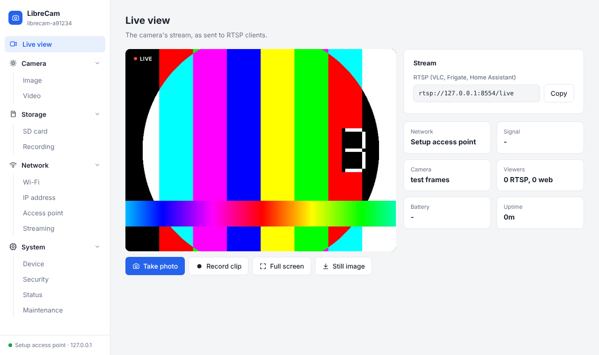
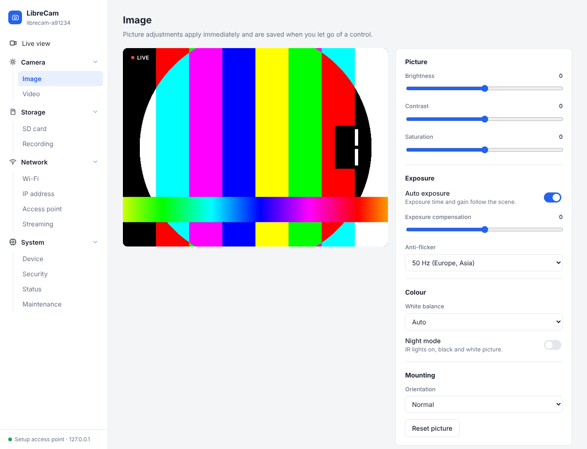
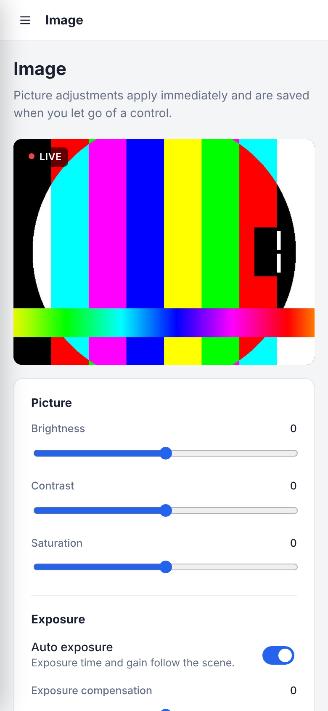
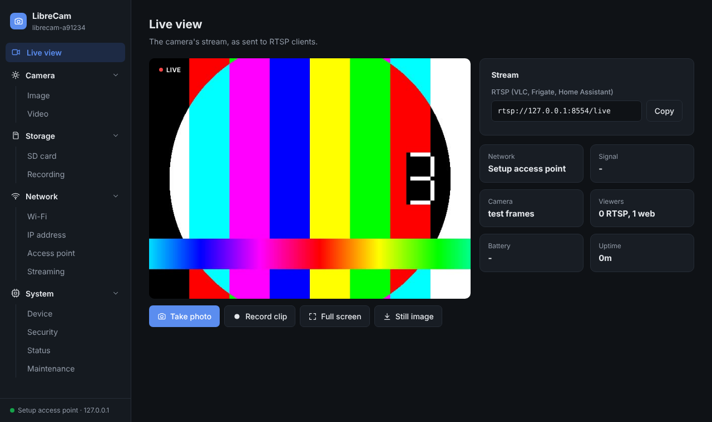

# LibreCam

Open replacement firmware for cheap cloud-locked Wi-Fi cameras. It runs entirely on the camera and needs no cloud account or app:

- **Web UI** with a live view, image controls (brightness, contrast, exposure, white balance, night mode), Wi-Fi and static IP settings, and an SD card browser
- **RTSP stream** with sound, for VLC, Frigate and Home Assistant
- **Found by name** on the local network over mDNS (`<device-name>.local`), with the web UI and stream advertised for discovery
- **SD card recording**: photos and video clips
- **Setup access point** on first boot, or **Wi-Fi setup from the SD card** with a `wifi.txt` file
- **Deep sleep** on the power button

Chip and board specifics sit behind a HAL, so more cameras can be added. Everything beyond flashing is in [docs/details.md](docs/details.md).

<p align="center"></p>

## Screenshots

The web UI, rendered by the host build with its test pattern as the camera:

| Live view | Image controls | Phone | Dark theme |
|---|---|---|---|
| [](docs/screenshots/live-light.png) | [](docs/screenshots/image-light.png) | [](docs/screenshots/phone.png) | [](docs/screenshots/live-dark.png) |

## Flashing

| Board | Camera | Chip | Section |
|---|---|---|---|
| `a13-mini-bk7252` | "A13 mini" (PCB `INNO-IPC-48N-V2.5`) | Beken BK7252N | [A13 mini](#a13-mini-bk7252n) |

### A13 mini (BK7252N)

**You need:**
- A **3.3 V** USB-to-UART adapter (FT232, CP2102 or CH340). Never use 5 V logic.
- A way to power-cycle the camera while the flasher waits: a switch on its supply works well.
- Chrome, Edge or Opera on a desktop computer for the web flasher, or Linux with Python 3 for the command line.

**1. Wire the UART pads**

| Adapter | Camera pad |
|---|---|
| TX | RX1 |
| RX | TX1 |
| GND | GND |

Power the camera from its own supply. The adapter's 3.3 V pin is usually too weak for Wi-Fi.

**2. Flash from the browser.** Open the **[web flasher](https://shristov92.github.io/LibreCam/)**, choose "Install LibreCam", press the button, pick the adapter's port and power-cycle the camera. While the camera still runs its stock firmware, it first reads the whole flash and downloads it as `librecam-stock-backup-….bin`: keep that file, it is the only way back to stock. It skips the backup when the camera already runs LibreCam, or when you give it your backup file. It checks the camera's bootloader against the backup, or against the known Beken bootloader when there is none, then writes the latest build from `main`, verifies it and shows the boot log. "Restore stock" puts the original firmware back from the backup. The flasher runs entirely in the browser over Web Serial and makes the same checks as `flash.py` below. Then go to step 6.

**Or from the command line (steps 2 to 5):**

**2. Install the tools**

```sh
python3 -m venv ~/tools/bkflash && ~/tools/bkflash/bin/pip install bk7231tools pyserial
```

**3. Back up the stock firmware.** This is the only way back to stock, so keep the file. Start the command, then power-cycle the camera. The script waits up to 2 minutes for the bootloader, and the read takes about 4 minutes.

```sh
~/tools/bkflash/bin/python -I firmware/hal/bk7252/flash.py --port /dev/ttyUSB0 --read stock_backup.bin
```

**4. Get the image.** Either download it or build it:
- **Download:** `librecam-a13-mini-bk7252-<version>.bin` from the [releases](../../releases), or from the artifacts of a CI run under Actions.
- **Build:** the script below fetches the pinned [Beken FreeRTOS SDK](https://github.com/YanMinge/beken_freertos_sdk_release) and GNU Arm toolchain 10.3, about 1 GB, into `~/.cache/librecam`.

```sh
ci/build-board.sh a13-mini-bk7252      # -> dist/librecam-a13-mini-bk7252-<version>.bin
```

**5. Flash.** Start the command, then power-cycle the camera.

```sh
~/tools/bkflash/bin/python -I firmware/hal/bk7252/flash.py --port /dev/ttyUSB0 \
  --backup stock_backup.bin dist/librecam-a13-mini-bk7252-<version>.bin
```

The script refuses to write unless the camera's bootloader matches your backup. Without `--backup` (for example on a camera that already runs LibreCam), the bootloader must be the known Beken one instead. It writes only the app region and leaves the bootloader and the RF and vendor data alone. It verifies the result and then shows the boot log.

**6. Set it up.**
1. Join the Wi-Fi network `LibreCam-Setup-XXXX`.
2. Open `http://192.168.4.1/`.
3. Open Network > Wi-Fi, enter your home network and click "Save and restart". The camera is then at `http://<device-name>.local/` (for example `http://librecam-a1b2c3.local/`), and the stream at `rtsp://<camera-ip>:554/live`.

**Back to stock:**

```sh
~/tools/bkflash/bin/python -I firmware/hal/bk7252/flash.py --port /dev/ttyUSB0 --restore-stock stock_backup.bin
```
