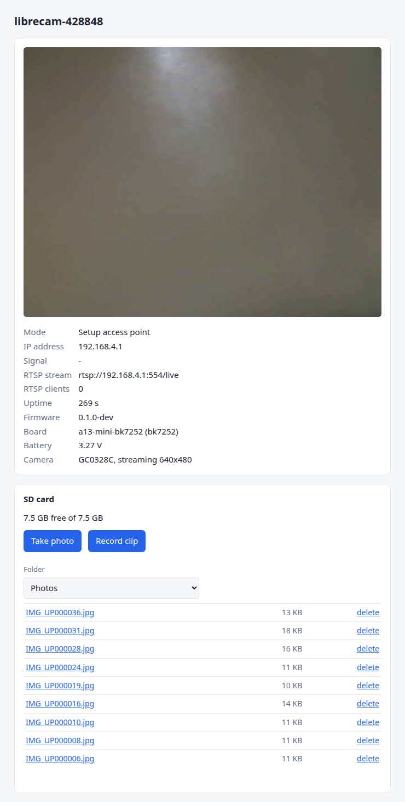
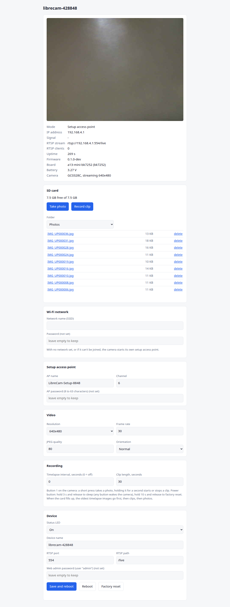
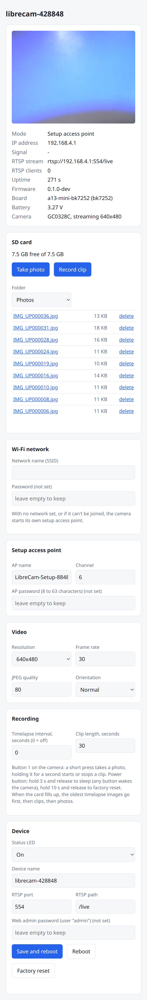
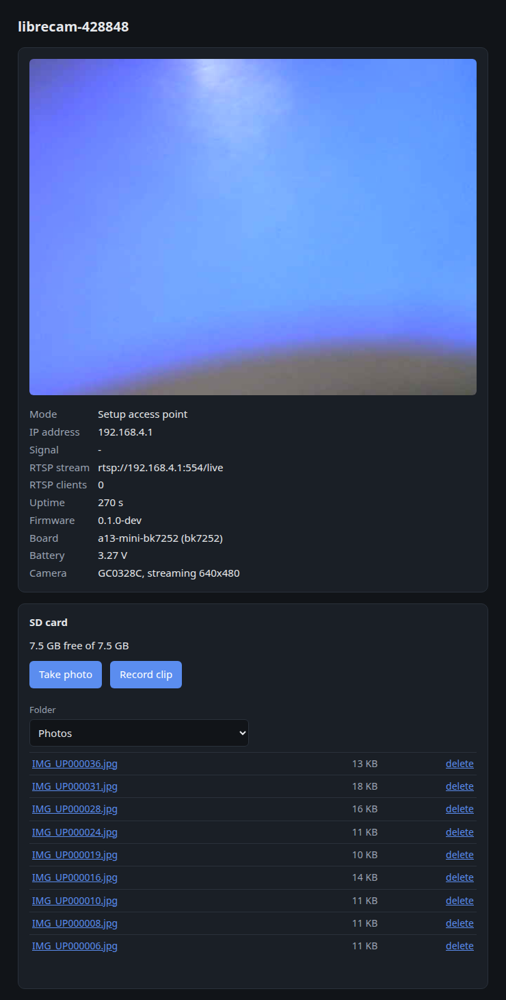

# LibreCam

Open replacement firmware for cheap cloud-locked Wi-Fi cameras. It runs entirely on the camera and needs no cloud account or app:

- **Web UI** with live preview, settings and an SD card browser
- **RTSP stream** with sound, for VLC, Frigate and Home Assistant
- **SD card recording**: photos, timelapse and video clips
- **Setup access point** on first boot
- **Deep sleep** on the power button

Chip and board specifics sit behind a HAL, so more cameras can be added. Everything beyond flashing is in [docs/details.md](docs/details.md).

<p align="center"></p>

## Screenshots

The web UI as served by the camera (A13 mini, GC0328C sensor, setup AP mode):

| Overview | Full page | Phone | Dark theme |
|---|---|---|---|
| [](docs/screenshots/overview-light.png) | [](docs/screenshots/web-ui-light.png) | [](docs/screenshots/web-ui-phone.png) | [](docs/screenshots/overview-dark.png) |

## Flashing

| Board | Camera | Chip | Section |
|---|---|---|---|
| `a13-mini-bk7252` | "A13 mini" (PCB `INNO-IPC-48N-V2.5`) | Beken BK7252N | [A13 mini](#a13-mini-bk7252n) |

### A13 mini (BK7252N)

**You need:**
- A **3.3 V** USB-to-UART adapter (FT232, CP2102 or CH340). Never use 5 V logic.
- A way to power-cycle the camera while a command runs: a switch on its supply works well.
- Linux with Python 3.

**1. Wire the UART pads**

| Adapter | Camera pad |
|---|---|
| TX | RX1 |
| RX | TX1 |
| GND | GND |

Power the camera from its own supply. The adapter's 3.3 V pin is usually too weak for Wi-Fi.

**2. Install the tools**

```sh
python3 -m venv ~/tools/bkflash && ~/tools/bkflash/bin/pip install bk7231tools pyserial
```

**3. Back up the stock firmware.** This is the only way back to stock, so keep the file. Start the command, then power-cycle the camera. The script waits up to 2 minutes for the bootloader, and the read takes about 4 minutes.

```sh
~/tools/bkflash/bin/python -I firmware/hal/bk7252/flash.py --port /dev/ttyUSB0 --read stock_backup.bin
```

**4. Build** (until there are release images). You need:
- [Beken's FreeRTOS SDK](https://github.com/YanMinge/beken_freertos_sdk_release)
- the 64-bit [GNU Arm toolchain 10.3-2021.10](https://developer.arm.com/downloads/-/gnu-rm)

```sh
BK_SDK=/path/to/beken_freertos_sdk_release \
FREERTOS_EXEC_PATH=/path/to/gcc-arm-none-eabi-10.3-2021.10/bin/ \
firmware/hal/bk7252/build.sh            # -> firmware/build/bk7252/lc_app.bin
```

**5. Flash.** Start the command, then power-cycle the camera.

```sh
~/tools/bkflash/bin/python -I firmware/hal/bk7252/flash.py --port /dev/ttyUSB0 \
  --backup stock_backup.bin firmware/build/bk7252/lc_app.bin
```

The script refuses to write unless the camera's bootloader matches your backup. It writes only the app region and leaves the bootloader and the RF and vendor data alone. It verifies the result and then shows the boot log.

**6. Set it up.**
1. Join the Wi-Fi network `LibreCam-Setup-XXXX`.
2. Open `http://192.168.4.1/`.
3. Enter your home Wi-Fi under "Wi-Fi network" and click "Save and reboot". The stream is then at `rtsp://<camera-ip>:554/live`.

**Back to stock:**

```sh
~/tools/bkflash/bin/python -I firmware/hal/bk7252/flash.py --port /dev/ttyUSB0 --restore-stock stock_backup.bin
```
